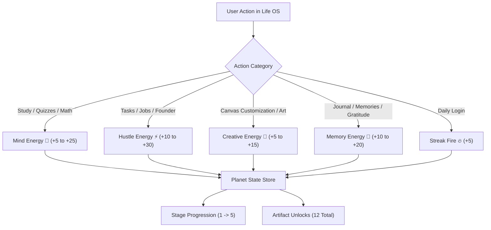

# 🪐 Life OS — Your Personal Creative Universe & Life Operating System

[](https://nextjs.org/)
[](https://react.dev/)
[](https://www.typescriptlang.org/)
[](https://tailwindcss.com/)
[](https://groq.com/)
[](https://github.com/pmndrs/zustand)
[](LICENSE)

> **Life OS** is a personalized, AI-powered life operating system and spatial creative workspace. Study, plan, engineer, build startups, track careers, and journal memories — all within an interactive freeform canvas and an evolving celestial planet gamification engine.

---

## 📑 Table of Contents

- [Vision & Core Concept](#-vision--core-concept)
- [Key Architectural Decisions](#-key-architectural-decisions)
- [Feature Modules](#-feature-modules)
  - [1. 🎨 Canvas as Home (Spatial Workspace)](#1--canvas-as-home-spatial-workspace)
  - [2. 🧩 Interactive Desktop Widgets](#2--interactive-desktop-widgets)
  - [3. 🪐 Planet Gamification System](#3--planet-gamification-system)
  - [4. 📚 Study Mode (AI Learning Hub)](#4--study-mode-ai-learning-hub)
  - [5. 💼 Job Mode (Career Operating System)](#5--job-mode-career-operating-system)
  - [6. 📖 Memory Journal (Reflective Life Log)](#6--memory-journal-reflective-life-log)
  - [7. 📐 Vector Mode (AI Math & Graph Studio)](#7--vector-mode-ai-math--graph-studio)
  - [8. 🚀 Founder Mode (Startup Launchpad)](#8--founder-mode-startup-launchpad)
  - [9. 🛠️ Builder Mode (Developer Kanban & Issues)](#9--builder-mode-developer-kanban--issues)
- [Tech Stack](#-tech-stack)
- [Project Architecture & Directory Structure](#-project-architecture--directory-structure)
- [Getting Started](#-getting-started)
  - [Prerequisites](#prerequisites)
  - [Installation](#installation)
  - [Environment Variables](#environment-variables)
  - [Running the App](#running-the-app)
- [How Gamification Works (Planet Energy Matrix)](#-how-gamification-works-planet-energy-matrix)
- [Upcoming Roadmap](#-upcoming-roadmap)
- [Contributing & License](#-contributing--license)

---

## 🌌 Vision & Core Concept

Most productivity apps force users into rigid tables, boring databases, or cluttered dashboard cards. **Life OS** flips this model:

1. **Your Workspace is a Freeform Canvas**: The home screen *is* your desktop canvas. Arrange widgets, pin notes, draw sketches, customize themes, and drop stickers anywhere you want.
2. **Context Without Disruption (Side-Panel Architecture)**: Heavy workflows (studying, interview prep, pitch decks, math problems) slide out as high-performance side panels over your canvas, preserving your visual focus and spatial context.
3. **Intrinsic Gamification (The Living Planet)**: Instead of arbitrary XP points or punitive streaks, every constructive action feeds energy into your personal planet — evolving it from a barren rock into a glowing cosmic metropolis.
4. **Local-First & Cloud-Ready**: Operates instantly out-of-the-box using `localStorage` with zero database friction, while offering native Supabase integration for cloud authentication and backup.

---

## 🏛️ Key Architectural Decisions

| Decision | Implementation | Why It Matters |
| :--- | :--- | :--- |
| **Canvas-as-Home** | `/canvas` is the post-login destination | Eliminates dull dashboards; users enter a visual, bespoke environment. |
| **Local-First Auth** | `lib/local-auth.ts` + `localStorage` | Instant load times, zero onboarding friction, complete user privacy by default. |
| **Side-Panel Navigation** | `SidePanel.tsx` + `FloatingDock.tsx` | All 6 major modes open in an animated drawer without page reloads. |
| **Ultra-Fast LLM Inference** | Groq API (`llama-3.3-70b-versatile`) via Vercel AI SDK | Near-instant AI completions for note generation, solvers, and resumes. |
| **Rich Text & Ink Hybrid** | Tiptap WYSIWYG + HTML5 Canvas | Seamlessly switch between markdown-level text editing and freehand drawing. |

---

## 🚀 Feature Modules

### 1. 🎨 Canvas as Home (Spatial Workspace)
- **Freeform Drag & Drop**: Place widgets and stickers freely on a full-screen canvas.
- **Transform Controls**: 4-corner interactive resizing handles and 15° incremental rotation.
- **Curated Sticker Bundles**: 7 preloaded themed packs (*Spiderman*, *Stars & Space*, *Hearts & Love*, *Flowers & Nature*, *Batman*, *Kawaii*, *Gamer*).
- **Custom Sticker Uploader**: Drag & drop or upload personal image assets persisted to local storage.
- **Canvas Theming**: Solid backgrounds, smooth CSS gradients, custom hex palettes, and 4 one-click starter templates (*Cosmic Dark*, *Soft Aesthetic*, *Clean Minimal*, *Blank Canvas*).
- **Theme Sharing**: Export themes or share complete canvas setups via base64 encoded URL strings (`?theme=...`).

### 2. 🧩 Interactive Desktop Widgets
- **📝 Multi-Page Notes Widget**:
  - Tabbed multi-page notebooks with inline page renaming and deletion.
  - Powered by **Tiptap**: Bold, italic, underline, custom text colors, 6 vibrant highlight shades, and text alignment.
  - **Draw Mode**: Toggle an integrated freehand drawing canvas with customizable brush colors and stroke sizes.
  - Export notes to `.txt` files with one click.
- **⏱️ Pomodoro Focus Timer**:
  - Focus session manager with preset intervals, pause/resume, and real-time circular tracking.
- **📊 4-in-1 Productivity Tracker Widget**:
  - **Tasks Tab**: Categorized task checklist with priority flags (*Low*, *Medium*, *High*), daily date navigation, and completion timestamps.
  - **Calendar Tab**: Monthly/daily visual agenda with calculated productivity percentages.
  - **Timetable Tab**: Weekly schedule grid (Monday–Sunday × 08:00–20:00) with color-coded course/task time-blocks.
  - **Stats Tab**: Aggregate productivity breakdown, category analysis, and task distribution charts.

### 3. 🪐 Planet Gamification System
Your personal planet is a celestial representation of your daily growth:
- **5 Evolution Stages**:
  - `Stage 1: 🌑 Barren Rock` (0+ energy)
  - `Stage 2: 🌒 First Spark` (20+ energy)
  - `Stage 3: 🌍 Living World` (75+ energy)
  - `Stage 4: 🌟 Thriving City` (200+ energy)
  - `Stage 5: 🌌 Legendary Universe` (500+ energy)
- **4 Energy Dimensions**:
  - **Mind Energy (🧠)**: Gained through reading, solving math, writing notes, and acing quizzes.
  - **Hustle Energy (⚡)**: Gained by checking off tasks, job tracking, and founder planning.
  - **Creative Energy (🎨)**: Gained by customizing canvas themes, placing stickers, and drawing.
  - **Memory Energy (💎)**: Gained from recording gratitude, logging milestones, and photo journaling.
- **12 Unlockable Artifacts**:
  - *Ancient Scroll*, *Library Tower*, *Iron Hammer*, *Golden Trophy*, *Crystal Ball*, *Flame Torch*, *Solar Crown*, *Briefcase*, *Memory Crystal*, *Living World*, *Legendary Universe*, *Century Stone*.
- **Streak & Fire Tracking**: Daily login bonuses, consecutive day streaks, and bottom-sheet unlock toasts.

### 4. 📚 Study Mode (AI Learning Hub)
- **AI Notes Generator**: Produce comprehensive structured notes, *Explain Like I'm 5 (ELI5)* simplifications, or rapid summaries for any academic topic. Save results directly into your canvas Notes widget.
- **Brain Dump to Order**: Input messy, unstructured thoughts; Groq AI reorganizes them into clear, formatted action plans.
- **Tiered Flashcards**: Auto-generate flashcards across 3 mastery levels (*Basic*, *Intermediate*, *Advanced*) with 3D flip card interactions.
- **Quiz Arena**: Timed interactive quizzes with real-time score calculation and detailed explanations.
- **Interactive Mind Map**: Visual tree exploration of complex topics; click any node to auto-expand child branches or fetch instant AI definitions.

### 5. 💼 Job Mode (Career Operating System)
- **Job Application Pipeline**: Track roles across 5 recruitment stages (*Wishlist*, *Applied*, *Interview*, *Offer*, *Rejected*) with salary, company notes, and interview dates.
- **5-Step AI Resume Builder**: Step-by-step career history intake with AI bullet enhancement, live preview, and instant export to `.html` or `.txt`.
- **AI Mock Interview Coach**: Generates role-specific behavioral and technical interview questions, rates user responses from 1–10, and delivers tactical feedback.
- **Skill Gap Analyzer**: Analyzes target job titles against current proficiencies to produce a prioritized learning roadmap with time estimates.
- **Cold Outreach / DM Generator**: Drafts high-conversion outreach emails and LinkedIn messages in *Professional*, *Friendly*, or *Bold* tones.

### 6. 📖 Memory Journal (Reflective Life Log)
- **Photo & Memory Journal**: Upload photo snapshots accompanied by AI tone rewriting (*Deep*, *Aesthetic*, *Funny*, *Minimal*).
- **Life Timeline**: Visual chronological chapters of your life milestones tagged with custom emojis, colors, and key events.
- **Gratitude Journal**: Daily gratitude logs with mood tracking, consistency streaks, and automated AI reflection prompts.

### 7. 📐 Vector Mode (AI Math & Graph Studio)
- **Smart Calculator**: Keyboard-accessible scientific calculator with full audit history.
- **AI Equation Solver**: Step-by-step breakdown and mathematical explanation of algebraic, calculus, or vector problems.
- **SVG Function Grapher**: Native SVG-based multi-function plotter with dynamic zoom and pan.
- **Practice Arena**: Infinite math problem generator customized by topic and difficulty level.

### 8. 🚀 Founder Mode (Startup Launchpad)
- **Idea Validator**: Instant market analysis evaluating problem validity, revenue potential, competition risk, and a composite viability score.
- **7-Part Pitch Builder**: Formulate a complete investor-ready pitch structure (*Problem*, *Solution*, *Market Size*, *Product*, *Business Model*, *Traction*, *Ask*).
- **3-Phase Roadmap**: Phased milestone execution plan with interactive progress checklist.
- **Weekly OKRs / Goals**: Goal tracker with category classification and real-time completion tracking.

### 9. 🛠️ Builder Mode (Developer Kanban & Issues)
- **Full Kanban Board**: Agile task management across *Backlog*, *In Progress*, *Review*, and *Done* columns.
- **Bug & Feature Triage**: Categorize issues by type (*Bug*, *Feature*, *Task*) and urgency (*Low*, *Medium*, *High*).
- **Detailed Card Metadata**: Append inline Markdown notes and sub-tasks to individual cards.

---

## 💻 Tech Stack

| Category | Technologies |
| :--- | :--- |
| **Framework** | Next.js 16.2 (App Router), React 19.2 |
| **Language** | TypeScript 5.x |
| **Styling** | Tailwind CSS v4, PostCSS |
| **Motion & UI** | Framer Motion, Lucide React |
| **State Management** | Zustand 5.0 (with local persistence) |
| **Rich Text Editor** | Tiptap (StarterKit, Highlight, Underline, TextStyle, Color, TextAlign) |
| **Freehand Canvas** | HTML5 Canvas / Fabric.js |
| **AI Inference** | Groq API (`llama-3.3-70b-versatile`) via Vercel AI SDK (`ai`, `@ai-sdk/groq`) |
| **Data & Auth** | Local-First (`localStorage`), optional Supabase SSR (`@supabase/supabase-js`) |

---

## 📁 Project Architecture & Directory Structure

```text
life-os/
├── app/
│   ├── api/ai/                # Serverless Next.js API Routes for AI Inference
│   │   ├── braindump/         # AI brain dump organizer
│   │   ├── define/            # Mind map term definer
│   │   ├── email/             # Cold outreach generator
│   │   ├── flashcards/        # Study flashcard generator
│   │   ├── founder/           # Startup validator, pitch & roadmap
│   │   ├── gratitude/         # Gratitude reflection prompts
│   │   ├── interview/         # Mock interview feedback & scoring
│   │   ├── journal/           # Memory tone enhancer
│   │   ├── mindmap/           # Mind map generation
│   │   ├── mindmap-expand/    # Dynamic mind map branch expansion
│   │   ├── notes/             # Academic AI note generator
│   │   ├── quiz/              # Quiz question generator & validator
│   │   ├── resume/            # AI resume content generator
│   │   ├── skillgap/          # Skill gap roadmap analyzer
│   │   └── vector/            # Math problem & equation solver
│   ├── auth/                  # Local and Supabase authentication view
│   ├── canvas/                # Core interactive spatial canvas (Home)
│   ├── dashboard/             # Legacy route (redirects to /canvas)
│   ├── study/                 # Standalone study interface
│   ├── globals.css            # Tailwind CSS v4 theme definitions
│   ├── layout.tsx             # Root layout with fonts & metadata
│   └── page.tsx               # Cosmic landing page & feature showcase
├── components/
│   ├── builder/               # KanbanBoard and task triage components
│   ├── canvas/                # Canvas engine (Toolbar, Dock, Background, Stickers, Templates)
│   ├── founder/               # IdeaValidator, PitchBuilder, Roadmap, WeeklyGoals
│   ├── job/                   # JobTracker, ResumeBuilder, InterviewPrep, SkillGap, ColdEmail
│   ├── journal/               # MemoryJournal, LifeTimeline, GratitudeJournal
│   ├── planet/                # PlanetView modal, ArtifactNotification toasts
│   ├── study/                 # AINotes, BrainDump, Flashcards, MindMap, QuizMode
│   ├── ui/                    # StarBackground canvas and reusable UI primitives
│   ├── vector/                # Calculator, EquationSolver, GraphVisualizer, PracticeMode
│   └── widgets/               # DraggableWidget shell, NotesWidget, TimerWidget, TrackerWidget
├── lib/
│   ├── default-canvas.ts      # Preconfigured canvas theme templates
│   ├── local-auth.ts          # Zero-config local authentication layer
│   ├── sticker-bundles.ts     # Curated sticker bundle datasets
│   ├── supabase.ts            # Optional Supabase client configuration
│   └── use-planet-energy.ts   # Action-to-energy dispatch hook
├── store/
│   ├── canvas-store.ts        # Zustand store: widgets, stickers, theme, active panels
│   └── planet-store.ts        # Zustand store: planet stages, energy levels, artifacts, streaks
└── types/
    └── index.ts               # Core TypeScript interface definitions
```

---

## 🛠️ Getting Started

### Prerequisites
- [Node.js](https://nodejs.org/) (version 18.18 or higher recommended)
- `npm`, `pnpm`, or `yarn`
- A [Groq Cloud API Key](https://console.groq.com/) for AI generation features.

### Installation

1. Clone the repository:
   ```bash
   git clone git@github.com:angelverman2021-a11y/lifeos.git
   cd lifeos
   ```

2. Install dependencies:
   ```bash
   npm install
   ```

### Environment Variables

Create a `.env.local` file in the root directory:

```env
# Required for AI Features (Notes, Resume, Quizzes, Vector, Founder modes)
GROQ_API_KEY=your_groq_api_key_here

# Optional: Supabase Cloud Database & Authentication (if migrating from local-first)
NEXT_PUBLIC_SUPABASE_URL=your_supabase_project_url
NEXT_PUBLIC_SUPABASE_ANON_KEY=your_supabase_anon_key
```

> **Note**: Even without API keys or Supabase configured, the Canvas, Widgets, Notes, Timetable, Tasks, Drawing, and Planet Gamification function 100% locally!

### Running the App

Start the development server:
```bash
npm run dev
```

Open [http://localhost:3000](http://localhost:3000) in your browser.

- Sign up or log in (or click **"Try Canvas"** directly).
- If visiting for the first time, pick your preferred canvas template (*Cosmic Dark*, *Soft Aesthetic*, *Clean Minimal*, or *Blank*).
- Use the **Top Toolbar** to add notes, timers, trackers, and stickers.
- Use the **Left Floating Dock** to switch between modes or inspect your evolving **Planet**.

---

## ⚡ How Gamification Works (Planet Energy Matrix)

Every task performed in Life OS contributes directly to your cosmic ecosystem:



| User Action | Energy Gained | Metric |
| :--- | :--- | :--- |
| **Note Created** | `+10` | 🧠 Mind |
| **Quiz Completed** | `+25` | 🧠 Mind |
| **Equation Solved** | `+15` | 🧠 Mind |
| **Task Completed** | `+10` | ⚡ Hustle |
| **Job Application Logged** | `+20` | ⚡ Hustle |
| **Resume Generated** | `+30` | ⚡ Hustle |
| **Idea Validated** | `+20` | ⚡ Hustle |
| **Theme Saved** | `+15` | 🎨 Creative |
| **Sticker Placed** | `+5` | 🎨 Creative |
| **Memory Logged** | `+20` | 💎 Memory |
| **Daily Gratitude** | `+10` | 💎 Memory |
| **Daily Check-in** | `+5` | 🔥 Streak |

---

## 🔮 Upcoming Roadmap

- [ ] **Social OS (Phase 6)**:
  - Theme Marketplace to discover and download community canvases.
  - Global and friend-based Planet Leaderboards.
  - Collaborative study and accountability rooms.
- [ ] **Mobile Touch Optimization**: Responsive bottom-sheet drawers and pinch-to-zoom canvas gestures.
- [ ] **Vector Mode Formula Importer**: One-click export of plotted graphs and solved formulas directly into canvas note cards.
- [ ] **Startup Metrics Tracker**: Live MRR, CAC, and Burn Rate tracking widgets inside Founder Mode.

---

## 📄 Contributing & License

Contributions, feature suggestions, and bug reports are warmly welcome!

1. Fork the Project
2. Create your Feature Branch (`git checkout -b feature/AmazingFeature`)
3. Commit your Changes (`git commit -m 'Add some AmazingFeature'`)
4. Push to the Branch (`git push origin feature/AmazingFeature`)
5. Open a Pull Request

Distributed under the **MIT License**. See `LICENSE` for more information.

---

<p align="center">
  Built with 💜 for lifelong learners, creators, and builders.
</p>

